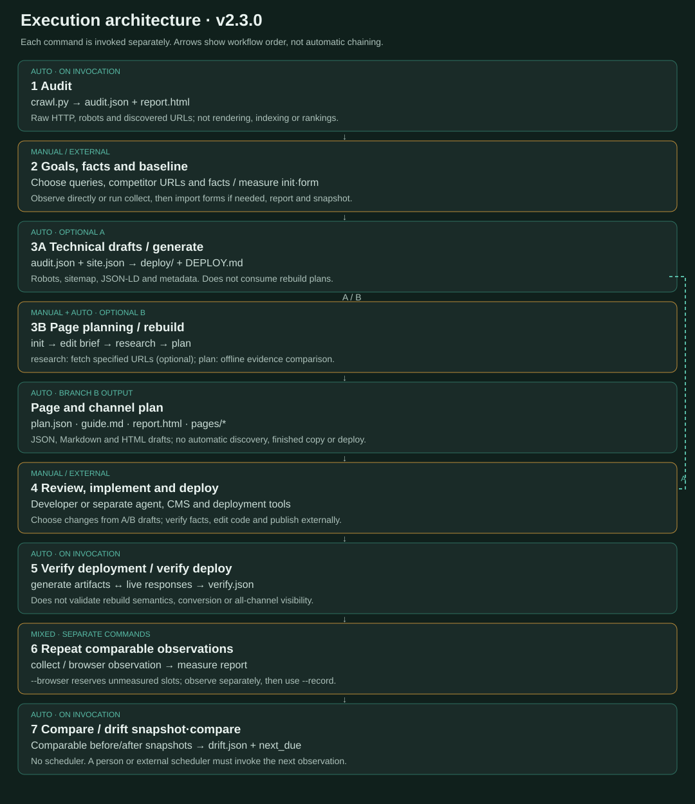

# su-presence


> Are we present in search and AI answers? SEO, AEO, GEO, LLMO, Naver and Daum as one surface. Hand-tuned by **su** ([kindsusu](https://github.com/kindsusu))

<p align="center">
  <a href="README.md"><b>English</b></a> ·
  <a href="README.ko.md">한국어</a>
</p>

<p align="center">
  <a href="https://github.com/kindsusu/su-presence/actions/workflows/ci.yml"></a>
  
  
  
  <a href="LICENSE"></a>
  
</p>

**A Korean-first toolkit that audits search and AI visibility, compares competitor sources with owned pages, and produces evidence-based rebuilding plans.** It keeps SEO, AEO, GEO, LLMO, Naver (NEO), Daum/Kakao (KEO), and reputation as separate evidence lanes; crawler access, index state, citations, and business outcomes are not treated as the same result.

## Version 3.0.0

**3.0.0** connects site audit, candidate source discovery, public-page research, evidence comparison and page design through a resumable `rebuild run`. The separate audit, measurement and deployment verification commands remain available.

- `rebuild run/status/resume` connects research and page design with durable progress. See the [automation guide](docs/plans/rebuild-automation-guide.md) for providers and configuration.
- Plan evidence-led page updates with the [content operations guide](ops/content.md) ([English](en/ops/content.md)), [content brief template](templates/content-brief.example.md), and [content inventory CSV](templates/content-inventory.example.csv). These are planning records, not performance forecasts.
- Build an evidence-linked page and channel plan with `python tools/rebuild.py init <audit.json>`, then explicit `research` and offline `plan`. The [rebuild guide](ops/rebuild.md) ([English](en/ops/rebuild.md)) explains inputs, immutable run outputs, and the [synthetic fixtures](templates/rebuild/brief.json). It drafts page changes; it does not publish or guarantee visibility.
- [Aside is optional](ops/aside.md) ([English](en/ops/aside.md)), for authenticated AI web UI work when a suitable existing session is available. Existing Python tools remain the path for audits and aggregation; no installation or sign-in is assumed, and no speed or coverage improvement is promised.
- Run `python tools/validate.py` to check repository documentation links and consistency.

The version badge describes this source tree. Check [Releases](https://github.com/kindsusu/su-presence/releases) for published packages and tags.

## Quick start

Choose one installation path. The plugin is convenient for Claude Code; a clone is useful for standalone local runs and development.

### Install the plugin

```text
/plugin marketplace add kindsusu/su-presence
/plugin install su-presence@su-presence
```

Run commands from the installed skill directory, not from the project being audited:

```bash
python <skill-root>/tools/seo_geo.py doctor
python <skill-root>/tools/seo_geo.py audit https://example.com --out <project>/out
```

### Clone and run locally

```bash
git clone https://github.com/kindsusu/su-presence.git
cd su-presence
python tools/seo_geo.py doctor
python tools/seo_geo.py audit https://example.com --out out
```

The audit writes `out/<host>/audit.json` and `report.html`. It honours applicable `robots.txt`, records crawl coverage, and returns exit code `2` when collection is incomplete. Read an incomplete audit as partial evidence, not a complete site inventory.

## From competitor evidence to page design

`rebuild` connects an existing audit with query observations and business facts. It distinguishes declared competitors from observed publishers, groups queries by intent, and proposes updates, new pages, or further review. Outputs include JSON/Markdown/HTML page drafts, evidence comparisons, channel actions, and technical prerequisites.

The connected workflow is the shortest route from a site and topic to a reviewable plan. The example configuration uses Brave Search; set `BRAVE_SEARCH_API_KEY` in the environment before running it. The runner only calls Brave when that provider is configured, and optional OpenAI analysis needs its own explicit configuration and API key.

```bash
python tools/seo_geo.py rebuild run https://example.com --topic "core service" --config templates/rebuild/run-config.json --out out/example.com/rebuild
# Use the run-* directory printed by the previous command.
python tools/seo_geo.py rebuild status out/example.com/rebuild/<run-id>
python tools/seo_geo.py rebuild resume out/example.com/rebuild/<run-id>
```

`status` reports saved stage results. `resume` reuses validated outputs; add `--refresh` to retry incomplete discovery, research or analysis after fixing their input. Missing search configuration becomes `needs_input`, and incomplete collection becomes `partial` (exit code `2`). An initial topic creates draft queries sharing one intent. Supply a reviewed `brief_file` in the configuration for confirmed business facts, page mappings and multiple intents. See the [automation guide](docs/plans/rebuild-automation-guide.md).

For explicit control of inputs and observations, use the original three commands:

```bash
python tools/seo_geo.py rebuild init out/example.com/audit.json
# Edit the generated brief: queries, competitor URLs, verified facts, and page mappings.
python tools/seo_geo.py rebuild research out/example.com/rebuild/brief.json --out out/example.com/research
# Supply research.json from the run-* directory printed above.
python tools/seo_geo.py rebuild plan out/example.com/audit.json --brief out/example.com/rebuild/brief.json --research <research.json> --out out/example.com/rebuild
```

Add recorded discovery/observations with `--observations <observations.json>` or compatible measurement logs with `--log <log.jsonl>`. Research fetches specified URLs; it does not automatically query search engines or authenticated AI products. Planning is offline. Failed fetches, empty HTML, and unmeasured channels do not establish absence of visibility. Page drafts require factual and editorial review.

Search hits are candidate sources, not proof of AI citations. Fact checking, login-only observations, implementation, and publishing remain human or external tasks. Aside is not invoked by the runner.

[Workflow guide](en/ops/rebuild.md) · [Synthetic example](templates/rebuild/brief.json) · [Validation record (Korean)](docs/reviews/2026-10-13-rebuild-validation.ko.md) · [Reference review (Korean)](docs/reviews/2026-10-13-reference-projects.ko.md)

## The practical loop

This is a **command-driven CLI**. `rebuild run` chains its own research and planning stages after invocation and records progress for resume. Technical drafts (`generate`) remain a separate branch, with no automatic handoff or deployment. See the [execution architecture and automation boundaries](docs/architecture.md) and [interactive diagram](docs/diagrams/runtime-architecture.html).


The diagram above shows the current execution paths. The original lifecycle diagram below remains useful for the audit, deployment and remeasurement loop.



### Before changing the site: record a baseline

`compare` needs at least two dated snapshots. Capture the first audit and citation cohort **before** generating or deploying changes. Initialise the query set before making a form, then import the filled form and create its report before snapshotting it.

```bash
# 1. Audit and record the pre-change citation cohort
python tools/seo_geo.py audit https://example.com --out out
python tools/seo_geo.py measure init out/example.com/audit.json
python tools/seo_geo.py measure form out/example.com/audit.json \
  --engines chatgpt,gemini,claude,perplexity --runs 5
python tools/seo_geo.py measure import out/example.com/audit.json \
  out/example.com/measure/form-YYYY-MM-DD-filled.csv
python tools/seo_geo.py measure report out/example.com/audit.json
python tools/seo_geo.py drift snapshot out/example.com/audit.json \
  --measure out/example.com/measure/summary.json --baseline
```

### Generate, deploy, and verify

Copy [`templates/site.example.json`](templates/site.example.json) to `out/<host>/site.json` and enter only confirmed company facts before generating drafts. Generated files are drafts; a human reviews them and deploys only to an authorized environment.

```bash
python tools/seo_geo.py generate all out/example.com/audit.json \
  --site out/example.com/site.json

# After deployment, check the values the live server actually returns.
python tools/seo_geo.py verify deploy out/example.com/audit.json
```

`verify deploy` checks what the live server returns; matching a JSON-LD `@type` alone is not enough, and structured-data values are also compared with visible text where applicable.

### After the change: re-measure, take a second snapshot, and compare

On a later date, use the same query cohort and conditions. Re-audit, import the completed second form, report it, then take the second snapshot. Only then does `compare` have before/after evidence to compare.

```bash
python tools/seo_geo.py audit https://example.com --out out
python tools/seo_geo.py measure form out/example.com/audit.json \
  --engines chatgpt,gemini,claude,perplexity --runs 5
python tools/seo_geo.py measure import out/example.com/audit.json \
  out/example.com/measure/form-YYYY-MM-DD-filled.csv
python tools/seo_geo.py measure report out/example.com/audit.json
python tools/seo_geo.py drift snapshot out/example.com/audit.json \
  --measure out/example.com/measure/summary.json
python tools/seo_geo.py drift compare out/example.com/audit.json
```

`noindex` is a finding to investigate, not proof that every page or result is invalid. Intentional non-indexable paths can be declared with `--allow-noindex`; the audit records what it observed. `status` only reports locally recorded artifacts and never proves a current deployment, index, citation, or scheduled run.

Replace `YYYY-MM-DD` with the actual form date. Fill the generated CSV with observed results,
save it as `-filled.csv`, or pass the actual saved filename to `import`.

## What each artifact means

| Stage | Main artifacts | What they establish |
|---|---|---|
| `audit` | `audit.json`, `report.html` | Raw HTTP observations and the actual collection scope |
| `rebuild init/research/plan` | `brief.json`, `research.json`, `plan.json`, `guide.md`, `pages/*` | Manual/external brief editing and URL selection; command-triggered fetching and offline planning; separate implementation/deployment |
| `rebuild run/resume/status` | `run.json`, `brief.json`, `audit.json`, `discovery.json`, `research.json`, `analysis.json`, `plan.json` | Saved stage status and evidence-linked drafts; provider gaps remain explicit; no publishing |
| `generate` | `deploy/`, `DEPLOY.md` | Reviewable deployment drafts, never a completed deployment |
| `verify deploy` | `verify.json`, `VERIFY.md` | Live-response checks after deployment; exit `1` is a verified failure and `2` is incomplete or invalid scope |
| `measure` | manual form, `log.jsonl`, `summary.json`, `MEASURE.md` | Repeated citation observations for a fixed cohort; API and web UI are separate surfaces |
| `collect.py` | rows in `measure/log.jsonl` | **Collection attempts and explicit coverage gaps.** Naver, Daum, and Google AI Overviews have command-triggered collectors; `--browser` reserves login-walled engines as `unmeasured`; `--record` returns browser observations to the same log; `--coverage` names blanks. A truncated response, unavailable AI-source boundary, or source-fetch/parse failure is `unmeasured`, never zero. Organic search-result links are not AI citations. |
| `drift` | immutable `history/`, `drift.json`, `DRIFT.md` | Compared snapshots and a due date; `next_due` does not schedule work |

## Read next

- [Full tool guide](tools/README.md) — commands, schemas, exit codes, and generated files
- [Operating procedure](SKILL.md) — choosing a lane and using the skill from an installed location
- [Evidence boundaries](ops/evidence.md) — what a crawler audit can and cannot prove
- [Per-engine measurement recipes](ops/measure-playbook.md) — how to actually reach each engine, and the traps
- [Documentation index](docs/README.md)
- [Contributing](CONTRIBUTING.md)
- [Changelog](CHANGELOG.md)

## Scope and limits

- Python 3.10+ standard library only; `tools/audit.sh` additionally needs bash and curl.
- The audit reads raw HTTP HTML. It does not prove JavaScript rendering, vendor index state, rankings, or citations.
- Citation is observed through a fixed, repeated query cohort. It is never guaranteed by technical readiness; errors and unmeasured rows are kept separate from non-citations.
- Automated and browser rows made by `collect.py` carry a query fingerprint and campaign. Current and legacy v2 rows whose fingerprint is blank or no longer matches the query are excluded from aggregation and reported as incompatible; preserve those logs and re-measure them. Legacy v1 remains readable.
- **Measurement coverage is written next to the number.** Full sweep (`0/7`), representative query (`0 hits`) and not-measured are distinct; a partial sweep is never written as a full one.
- **A `0` may be your own tooling.** Bursts of repeated requests make search engines return truncated pages. A response that fails the sanity gate is recorded as a failed measurement, not as zero.
- Engines that require sign-in (ChatGPT, Gemini, Claude) are measured in each service's **temporary / incognito mode**. Anything the model drew from the account profile is not a web citation and is excluded from the tally.
- Naver (NEO) and Daum/Kakao (KEO) are **separate first-class lanes** — different crawler tokens, ownership proof and AI models. Citation measurement for both is automated in `tools/collect.py`. Registration, third-party reputation, and production deployment still require human decisions and access.
- The bounded crawl defaults to 300 pages. A failed declared sitemap or sitemap-index child makes coverage incomplete and blocks a replacement sitemap; an undeclared default sitemap returning 404 or 410 is optional.
- Mirror checks distinguish root `noindex`, robots-blocked, unrestricted, and unknown states; they do not prove every mirror host is indexable. A normal `www` to apex redirect is connectivity, not failure.

Check documentation links and repository consistency with:

```bash
python tools/validate.py
```

Run the local test suite with:

```bash
python -m unittest discover tests
```

## Contributors

- **[kindsusu](https://github.com/kindsusu)** — design, writing, maintenance
- **Claude** (Anthropic) — drafting, revisions, audit-tool pairing
- **Codex** (OpenAI) — adversarial code review (security and false-reading defects)

## License

**PolyForm Noncommercial 1.0.0** — see [LICENSE](LICENSE).

- **Free for personal, nonprofit, educational, and research use**
- **Commercial or corporate use is not permitted** under this license — for a separate commercial license, contact **scitusu@gmail.com**
