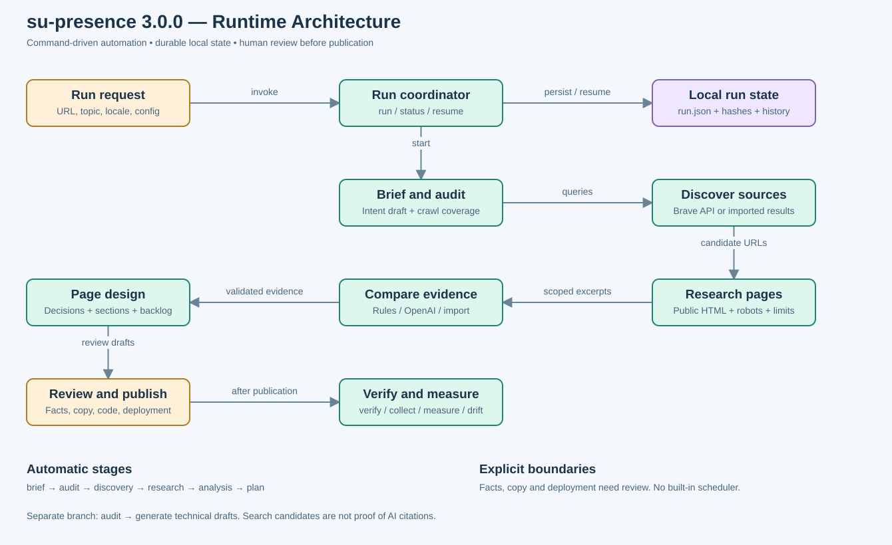

# 실행 아키텍처

su-presence는 명령 호출 시 동작하는 Python CLI와 Bash 보조 스크립트다. 상주 프로세스나 자체 스케줄러는 없다. `rebuild run`은 내부 단계를 연결하고 재개할 상태를 저장한다. 발행·배포는 별도 작업이다. [영문판](architecture.md) · [CLI 상세](../tools/README.md) · [자동화 안내](plans/rebuild-automation-guide.md)



[대화형 아키텍처 그림 열기](diagrams/runtime-architecture.html). 그림의 라벨은 영어이며 단계별 실행 경계는 아래에 설명한다.

## 두 작업 흐름

```text
rebuild run → 브리프 초안 → audit → 설정된 Brave 검색/외부 파일 → 공개 페이지 조사
            → 구조 분석(선택적 OpenAI/외부 분석) → 페이지 설계
            전체 단계는 run.json에 기록
rebuild status / resume → 저장된 실행 확인·재개
기존 경로: audit(crawl + report) ──┬──> generate(기술 수정 초안)
                                  └──> rebuild init → 수동 brief → research → plan

별도 측정: measure init → collect / 수동 폼 / 선택적 API auto → measure report
배포 후 확인: 사람이 배포 → verify → 재진단·재측정 → drift snapshot/compare
```

`generate`와 `rebuild`는 별도 경로다. `generate`는 robots·sitemap·메타데이터·구조화 데이터 등의 **기술 초안**을 만든다. `rebuild plan`은 질문 의도별 페이지 설계, 출처 비교, 채널별 조치와 우선순위 작업표를 만든다. `plan`은 `generate`를 자동 호출하지 않고, 어느 경로도 배포하지 않는다. 실제 발행·배포와 그 검증은 별도의 사람/외부 시스템 작업이다.

## 모듈과 호출 경계

| 모듈 | 실행과 책임 | 네트워크 |
|---|---|---|
| `tools/seo_geo.py` | `audit`, `status`, `doctor` 및 다른 CLI 전달. `audit`는 crawl·report를 함께 실행 | `audit`만 |
| `tools/crawl.py`, `report.py` | robots 정책을 존중하는 범위 제한 진단 → `audit.json`; 그 결과만으로 HTML 보고서 렌더링 | crawl만 |
| `tools/generate.py`, `verify.py` | 기술 배포 파일 초안 생성; 배포된 결과와 재진단 비교 | verify의 배포 확인 시 |
| `tools/measure.py`, `collect.py` | 질의 세트, 수동·API·검색 표면 관측, 로그 집계 | 수집·API 호출 시 |
| `tools/rebuild.py` | 초기 brief 생성, 명시 URL 조사, 오프라인 계획 및 보고서 출력 | `research`만 |
| `tools/rebuild_run.py` | 연결 실행의 단계 상태·입력 지문·산출물 해시 저장과 재개 | audit·discovery·research 단계 |
| `tools/rebuild_discovery.py`, `rebuild_analysis.py` | 검색 후보 검증 및 설정 범위의 근거 비교. 기본 분석은 구조 중심이며 의미 분석은 선택적 | 설정된 검색·선택적 분석 제공자 |
| `tools/rebuild_evidence.py`, `rebuild_plan.py` | brief 검증·제한된 URL fetch; 증거 연결과 의도별 계획 계산 | evidence fetch만 |
| `tools/drift.py` | 저장한 audit·측정·verify 스냅샷 비교와 다음 재측정일 계산 | 없음 |

`audit.sh`는 홈 1페이지의 레거시 빠른 점검이다. 범위와 후속 입력 계약은 `crawl.py`/`seo_geo.py audit`가 쓴 `audit.json`을 따른다. `seo_geo.py status`는 audit·deploy manifest·verify·measure·drift의 **로컬 파일 존재와 메타데이터**만 보여준다. rebuild 실행 폴더는 추적하지 않으며 현 배포·검색 성과를 재검증하지 않는다.

## 입력과 파일 계약

| 파일/폴더 | 생산자 → 소비자 | 성격 |
|---|---|---|
| `out/<host>/audit.json` (`su-presence/audit/1`) | audit → report, generate, verify, measure, rebuild, drift | 관측 범위(`coverage.complete`)가 포함된 진단. 불완전한 crawl은 누락 페이지의 증명이 아님 |
| `out/<host>/deploy/` 및 `.su-presence-generated.json` | generate → 사람의 배포 검토 | 기술 초안과 생성 파일 소유권 목록 |
| `out/<host>/measure/queries.json` (`su-presence/queries/2`, /1 읽기 지원) | measure init/사람 → collect·measure·rebuild init | 질문 집합 초안. 실제 질문·의도는 사람이 확정 |
| `out/<host>/measure/log.jsonl` (`su-presence/measure-row/2`) | collect·measure import/auto → measure report, 선택적 rebuild | 관측 조건과 결과를 지닌 append-only 기록. API와 UI는 별개 cohort |
| `out/<host>/measure/summary.json` (`su-presence/measure/2`) | measure report → drift | 관측된 회차의 집계. error·unmeasured는 미인용 0이 아님 |
| `out/<host>/rebuild/brief.json` (`su-presence/rebuild-brief/1`) | rebuild init/사람 → research·plan | 사업 사실·질문 의도·채널·선언된 경쟁 사이트. init은 기존 파일을 덮지 않음 |
| `out/<host>/rebuild/observations.json` (`su-presence/rebuild-observations/1`) | init/사람·외부 조사 → research·plan | 질문, 채널, 시간, 관측 URL·근거 URL을 연결. 경쟁사 선언과 실제 노출은 구분 |
| `out/<host>/rebuild/run-*/research.json` (`su-presence/rebuild-research/1`) | research → 선택적 plan 입력 | 명시 URL의 제한된 공개 페이지 스냅샷과 조사 범위 |
| `out/<host>/rebuild/run-*/plan.json` (`su-presence/rebuild-plan/1`) | plan → 사람 | 증거 ID를 연결한 설계·백로그. 같은 run에 `guide.md`, `report.html`, `pages/*.json|md|html` |
| `out/<host>/rebuild/run-*/run.json` (`su-presence/rebuild-run/1`) | run → status/resume | 저장된 단계 상태·입력 지문·산출물 해시. 상주 프로세스가 아님 |
| `discovery.json` (`su-presence/rebuild-discovery/1`) | 설정된 Brave Search·외부 파일 → research | 질문·제공자·시장·시각·잠정 역할이 연결된 URL 후보. AI 인용이 아님 |
| `analysis.json` (`su-presence/rebuild-analysis/1`) | 구조 분석, 선택적 OpenAI/외부 분석 → plan | 의도별 비교. 조사 본문이 뒷받침하는 분석만 출처를 연결하고 구조 분석의 한계는 명시 |
| `out/<host>/history/index.json` (`su-presence/history/1`), `drift.json` (`su-presence/drift/1`) | drift snapshot/compare → 사람 | 기준선·차이·계산된 `next_due`; 실제 예약은 없음 |

rebuild의 `research`와 `plan`은 각각 새 `run-*` 디렉터리를 만들고 이전 실행을 보존한다. `plan`은 research 파일 없이도 실행되지만 조사 범위가 미확인으로 남는다. 관측·측정 로그가 없어도 비관측 채널은 `unmeasured`로 표기한다. 확정되지 않은 사업 사실이나 보이지 않은 페이지를 추측해 채우지 않는다. 기술 출력과 페이지 설계 초안은 발행 전 사실·편집 검토가 필요하다.

## 관측 표면과 한계

`collect.py AUDIT`는 호출 시 네이버 AI 브리핑·다음·Google AI Overview의 출처 영역을 무인 수집한다. `--browser`는 ChatGPT·Gemini·Claude·Perplexity의 로그인 브라우저 관측 슬롯을 `unmeasured`로 **예약하고 안내**할 뿐 UI를 직접 조작하지 않는다. 브라우저에서 실제 관측한 결과는 `--record ENGINE --query ID ...`로 같은 로그에 `observed`로 남긴다. `--coverage`는 누락만 점검한다. `measure.py auto`는 키가 있을 때 OpenAI·Anthropic API 응답의 실제 인용만 선택적으로 관측한다. API 결과와 웹 UI 결과, 검색 켜짐/꺼짐, 로그인 상태는 같은 측정으로 합치지 않는다.

기존 개별 `rebuild research`는 지정된 URL만 가져오고 검색 결과를 새로 발견하지 않는다. 연결된 `rebuild run`에서는 설정된 Brave Search API 또는 검증된 외부 파일로 후보를 찾고, 그중 공개 페이지를 조사한다. 제공자가 없으면 `needs_input`으로 기록하고, 확보한 자사 근거로 제한된 계획을 만들 수 있다. 불완전한 진단·조사는 `partial`, 실패 단계와 그 후속 단계는 `run.json`에 표시된다. 초안이 생성되었더라도 전체 상태와 종료 코드는 미완료를 드러낸다. 검색 결과는 조사 후보이지 AI 인용이나 다른 검색엔진의 순위 관측이 아니다. 공개 HTTP(S) URL, DNS·리다이렉트·robots·응답 크기·시간·페이지 수 제한을 적용한다. 실패·차단된 문서는 미확인으로 남는다. 기본 분석은 구조 중심이다. OpenAI 또는 검증된 외부 분석을 선택하면 의도별 출처 문구를 연결할 수 있지만 사실성 검증까지 대신하지 않는다. `rebuild plan`과 `drift compare`는 저장 파일만 읽는다. 실행기는 Aside를 자동 호출하지 않는다. 저장된 실행의 `rebuild status`는 `run.json`을 읽으며 최상위 `seo_geo.py status`는 기존 사이트 산출물을 요약한다. `next_due`는 예약 작업이 아니다.

| 자동화 범위 | 필요한 사람/외부 입력 |
|---|---|
| 명령을 실행하면 audit·보고서·기술 초안·지정 표면 수집·근거 비교를 수행 | 명령 호출과 대상 지정, 기술 초안 배포 여부 판단 |
| `rebuild init`이 편집용 파일을 만들고 `research`가 명시 URL을 조사 | 질문 의도, 확인된 사업 사실, 실제 노출 URL·근거·시점 작성 |
| `rebuild run`이 브리프·진단·설정된 검색·조사·구조 또는 선택적 제공자 분석·설계를 연결하고 `resume`이 유효한 결과를 재사용 | 검색 제공자나 외부 파일 제공, 사업 사실·페이지 판단 검토, 별도 구현·발행 |
| `--browser`가 UI 측정 슬롯을 예약하고 `--record`가 입력된 결과를 저장 | 브라우저 로그인·관측 및 결과 기록, 또는 외부 오케스트레이터 연결 |
| `drift`가 저장된 관측의 차이와 `next_due`를 계산 | 다음 측정의 실제 예약·재실행 |

표의 rebuild 출력 경로는 `--out out/<host>/rebuild`를 사용한 예다. `research`는 `--out`을 반드시 지정하고, plan은 생략 시 audit 옆 rebuild 디렉터리를 사용한다.

## 선택적 설계 후 검토와 측정 프로토콜

페이지 설계 뒤 사람이 완성 본문을 작성하면 `rebuild review INPUT --out DIR`로 제공한 본문·주장·출처 발췌·날짜의 문자/구조 검사를 하고 명시적으로 입력한 프로필 필드를 대조할 수 있다. 별도 불변 `run-*`에 JSON·Markdown·HTML 보고서를 쓴다. 출처를 가져오거나 인증하지 않으며, 사실 여부나 의미상 답변 품질을 판정하거나 본문을 승인·게시하지 않는다. 사람은 검토 항목을 확인해 사실·편집 승인을 하고 구현·발행 여부를 결정해야 한다.

`rebuild protocol BRIEF --repeats N --out DIR`은 측정 가능한 비브랜드 질문과 설정된 AI 채널(없으면 기본 제공자)에 대해 비어 있는 반복 측정표를 만든다. 미분류 질문은 검토 대상으로 남기며 `pending` 슬롯은 관측 결과가 아니다. 이 프로토콜은 계획서이므로 측정 로그로 가져올 수 없다. 실제 관측은 기존 `measure` 수집·가져오기·보고 흐름에서 조건과 인용 URL을 기록해야 한다. 기준선과 후속 측정은 같은 질문·조건을 사용하고, 반복 관측은 탐색 표본이지 노출 확률이 아니다.

두 명령은 선택적 설계 후 작업이며 `rebuild run` 상태 기계에 새 단계를 추가하지 않는다. 따라서 아키텍처 그림은 바뀌지 않는다. 경계는 검토·측정 계획 산출 → 사람의 사실·편집 승인 → 별도 구현·발행 → 기존 측정 흐름에서 실제 관측 순서다.
