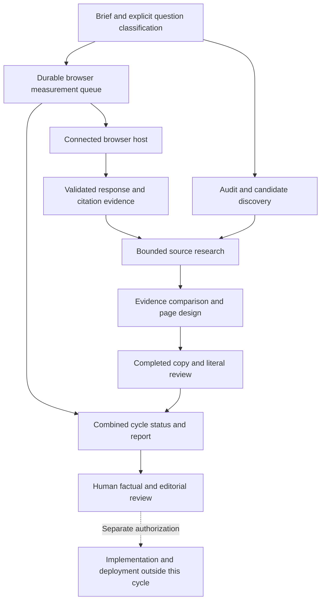

# Connected measurement and rebuild cycle

This optional workflow extends the existing six-stage runner with a durable measurement queue, observed-source inputs, and completed-copy review. It does not modify a website, publish content, or deploy. Keep customer inputs and outputs under ignored `out/`; public examples use fictional data.

## Run and resume

Prepare an existing rebuild brief with explicit `type: nonbrand` questions. Unclassified questions remain review items; the program does not guess that a branded question is nonbrand. Add `"cycle": {"repeats": 3}` to the run configuration. Existing configurations without `cycle` retain their original behavior.

```powershell
python tools/seo_geo.py rebuild run https://example.com --topic "service comparison" --config out/example.com/config.json --out out/example.com/rebuild
python tools/seo_geo.py rebuild status out/example.com/rebuild/RUN_ID
python tools/seo_geo.py rebuild resume out/example.com/rebuild/RUN_ID --config out/example.com/config.json
```

Optional cycle inputs are `observations_file`, `log_file`, `queue_file`, and `review_file`. Paths resolve relative to the configuration file. A supplied completed-copy review must use IDs from the current page blueprints. Changed inputs invalidate dependent artifacts; resume does not treat an old review as approval of changed copy.

Observed source URLs feed bounded public-page research and the page plan. Search-discovery candidates remain distinct from measured citations. A response with zero citations is still a measurement; it does not create a fictitious research URL. Partial source extraction can preserve known positive source evidence but cannot establish an absent citation.

## Browser host boundary

The stdlib CLI does not contain a browser or a login session. `rebuild browser` manages work for an explicitly connected browser-capable host. The host may use its supported browser API or an available Aside integration; the queue does not extract authentication tokens, install Aside, or silently switch products. Product descriptors specify the public entry URL, fresh-session procedure, answer-completion check, and citation inspection. They are not a claim that a changing website selector is tested and permanently supported.

```powershell
python tools/seo_geo.py rebuild browser init out/example.com/protocol.json out/example.com/queue.json
python tools/seo_geo.py rebuild browser next out/example.com/queue.json
python tools/seo_geo.py rebuild browser status out/example.com/queue.json
```

`next` claims a job; it does not submit a prompt itself. The host submits the exact question once, records `submit` with the returned slot/dispatch identifiers and session evidence, then supplies `record` with the actual result JSON. Python hosts can implement `BrowserBridge` and use `dispatch_one` to automate this handoff. An interrupted claimed/submitted job is retained for reconciliation rather than automatically sent again. Authentication, quota, unavailable browser, and changed UI are recorded as blocks, not negative observations. A human-confirmed retry is separate from automatic resumption.

Results bind to the run, dispatch, provider and question hash and retain actual model label, locale, search setting, fresh session, timestamp, response reference, answer-completion state and citation completeness. Login and subscription changes require the user's action. A live browser bridge must be connected and tested in its own host environment; fake bridge tests verify the local contract and recovery logic only.

## Interpretation and review

Organic search visibility, AI brand mention, and citation detection are separate fields. Missing legacy completeness metadata is unknown. Partial/unknown citation extraction does not enter the confirmed-absence denominator. Reports show actual per-engine/question counts instead of an averaged uniform repetition count. Repetition counts alone do not guarantee a representative sample or causal improvement.

Completed-copy review checks supplied text and evidence literally. Human fact checking, contractual accuracy and editorial judgment remain pending even if automated checks pass. The combined cycle report distinguishes research gaps, measurement blocks, pending copy review and excluded deployment. A suggested remeasurement date is not a scheduled automation.

## Runtime flow


